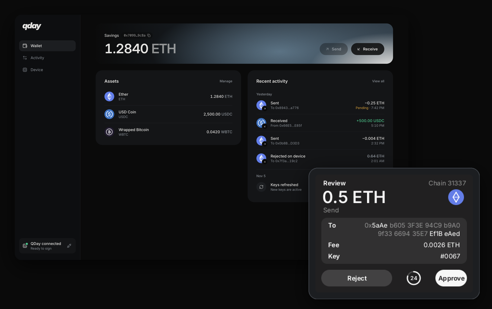
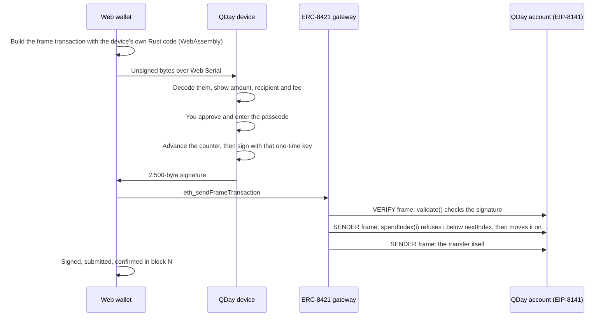
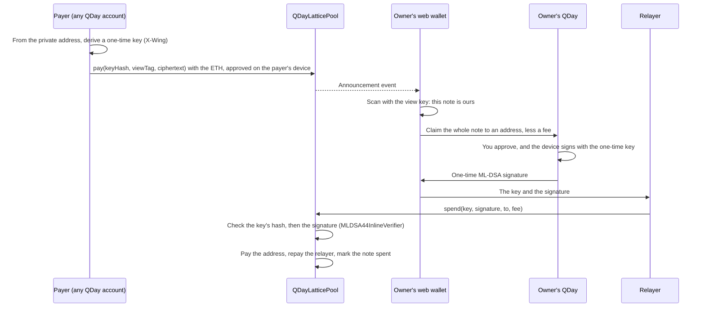
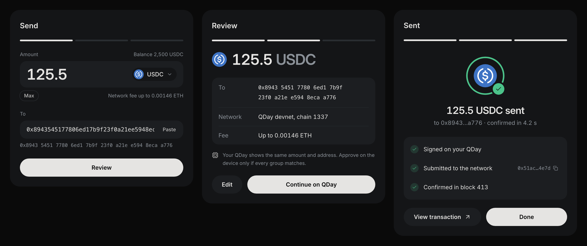
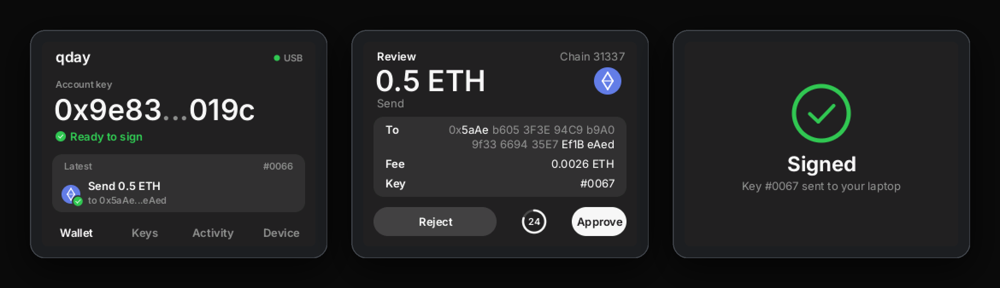
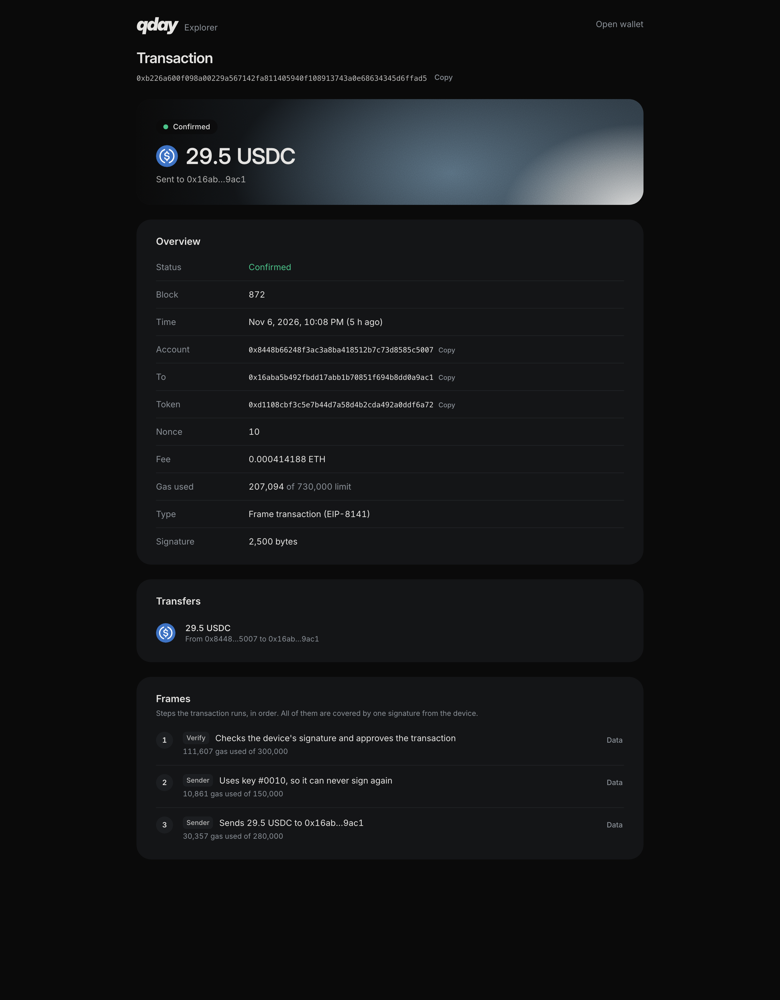
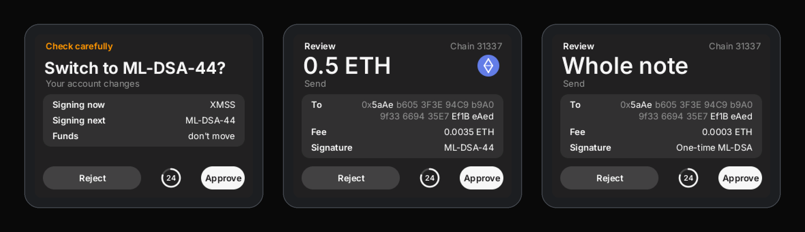
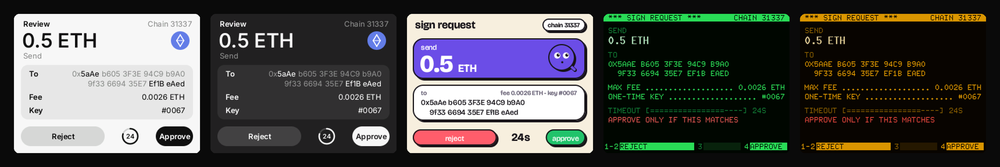

# QDay

**A quantum-safe hardware wallet for Ethereum.** A small device signs with post-quantum signatures,
hash-based XMSS or lattice-based ML-DSA-44 (NIST FIPS 204), and an EIP-8141 smart account accepts
nothing else: there is no ECDSA key anywhere. It also takes private payments: anyone can pay its
published private address, each payment lands somewhere only the owner can find, and only the device
can spend it.

- **First of its kind.** As far as we can find, the first hardware wallet that signs for Ethereum
  accounts with no ECDSA key at all. Earlier post-quantum hardware wallets sign for other chains, and
  Ethereum's post-quantum accounts so far keep ECDSA beside the new key
  ([fact-check](docs/fact-check.md#beyond-the-pitch), item 22).
- **Built on EIP-8141, Ethereum's next account model.** Frame transactions let an account's own code
  decide what a valid signature is and pay its own gas, which is what lets QDay drop ECDSA entirely.
  Core developers scheduled EIP-8141 for the Hegotá upgrade in August 2026, and the EF's protocol
  cluster ranks it one of two must-ship EIPs. QDay runs on it today, on its own devnet, signed on real
  hardware ([fact-check](docs/fact-check.md), item 6).
- **Quantum-safe by construction.** Every key QDay uses is post-quantum: XMSS, whose security rests on
  the hash function alone, and ML-DSA-44, NIST's standard. Nothing a quantum computer is known to break
  holds any authority over the funds.
- **Privacy built in, post-quantum end to end.** Private payments hide who was paid with X-Wing
  (ML-KEM-768 with X25519) and are spent with one-time ML-DSA keys, so neither finding nor spending a
  payment depends on an elliptic curve; X-Wing keeps X25519 only as a backstop beside ML-KEM. Post-quantum stealth-address proposals so far protect only the
  finding (item 23).

**[Open the wallet](https://qday.unitlabs.xyz)** (no device? select **Try without a device**) · [Roadmap](docs/ROADMAP.md) · [Signature spec](docs/xmss-spec.md) · [Measured on-chain](docs/devnet.md) · [For AI reviewers](AGENTS.md)



> Built at ETHGlobal Mumbai, November 2026. A working prototype on an EIP-8141 devnet: not audited, not
> for real funds. The demo's quantum attacker is simulated; the signatures, the counters and the
> on-chain checks are real.

## The problem

An Ethereum account's public key is revealed by its first transaction, and secp256k1 falls to Shor's
algorithm: 2026 estimates put the attack at about 1,200 logical qubits
([fact-check](docs/fact-check.md), item 1). Funds that sit in exposed accounts on that day can be taken,
and everyone will be trying to move at once. Hash-based signatures survive a quantum computer, but
they are one-time keys: sign two different messages with one key and it can be forged. They need
hardware that never reuses a key, and an account that checks. Private payments have the same
weakness: the stealth-address scheme in ERC-5564 is built on secp256k1 too.

## What QDay is

| | |
|---|---|
| **The device** | An ESP32-S3 with a touch screen and four keys. It holds two signature schemes from one seed, XMSS (1,024 one-time keys per tree) and ML-DSA-44, and you switch between them on the device. It decodes every transaction itself, shows exactly what it will sign, and signs only when you approve and enter your passcode. |
| **The accounts** | EIP-8141 smart accounts, one per scheme. The XMSS account checks a 2,500-byte hash-based signature in its VERIFY frame and moves `nextIndex` forward, so a used key is refused. The ML-DSA account checks a 2,420-byte FIPS 204 signature against its key, which lives in a data contract. |
| **Private payments** | A post-quantum stealth address. A payer derives a one-time ML-DSA key from it with X-Wing (ML-KEM-768 with X25519) and pays a shared pool; the owner's wallet finds the payment with a view key that can't spend, and the device signs the claim. |
| **The wallet** | A web app that connects to the device over USB with Web Serial: create the account, send ETH and tokens, pay and claim privately, follow each step, and read every transaction back with a built-in explorer. |
| **The network** | QDay's own EIP-8141 devnet, always on: ethrex, Lighthouse and the ERC-8421 gateway that carries frame transactions. EIP-8141 isn't on mainnet yet; it is scheduled for the Hegotá upgrade. |

## Why this design

- **Two schemes, because each bets on something different.** XMSS rests only on the hash function,
  which a quantum computer weakens but doesn't break, but it is stateful and needs the counter.
  ML-DSA-44 is NIST's standard (FIPS 204), stateless and with no counter to protect, and rests on a
  lattice problem; its check costs about 1.25M gas against about 120,000 for XMSS. The same 24 words
  back up both, and the device switches only after you approve.
- **A hardware device** because those signatures are stateful: a key must never sign twice, and NIST
  SP 800-208 expects that state to live in dedicated hardware. A laptop wallet can be copied or rolled
  back; the device holds the counter.
- **An EIP-8141 account** because the account itself decides what a valid signature is and pays its
  own fees, so there is no ECDSA key left in charge. A frame transaction carries the account's own
  checks in a VERIFY frame, so a 2,500-byte or 2,420-byte post-quantum signature is just data the
  account reads. EIP-7702 delegation, by contrast, keeps the old ECDSA key able to sign
  ([fact-check](docs/fact-check.md), item 18), and ERC-4337 needs a bundler's ECDSA transaction to
  carry the operation. EIP-8141 is also where Ethereum is heading: it is scheduled for the Hegotá
  upgrade.
- **A second lock on-chain** because hardware can fail or be cloned: `nextIndex` makes the account
  refuse any key it has already accepted.
- **Private payments from post-quantum parts.** X-Wing gives payer and owner a shared secret, which
  turns the owner's published ML-DSA key into a one-time key that only the owner's device can sign
  for. Nothing is deployed per payment: the pool takes the key in calldata when it's spent, and every
  key shares one matrix contract.

## Status

| | |
|---|---|
| **Works today** | XMSS and its Solidity verifier; the EIP-8141 account with both locks and rotation; self-deploying accounts; ML-DSA-44 signing on the device, its account and factory; private payments (pay, find, claim); the device (decoding, approval, passcode, backup and restore, scheme switching, five themes); the web wallet (connect, create, send ETH and ERC-20, private payments, activity, explorer); a demo wallet in the browser, so anyone can try it without a device; the hosted devnet and wallet |
| **Partly** | ML-DSA accounts send ETH only, and the devnet's dev key pays for deploying them, because the key is too large for the account to deploy itself. Private payments carry ETH only, the dev key relays claims (repaid from the note), and the one-time signer is an unreviewed variant, so test networks only. Key refresh and restore run from the device and the [CLI](crates/qday-cli), not yet from the web wallet |
| **Simulated** | The quantum attacker in the demo |
| **Not built** | Hardware rollback protection (eFuse or secure element), connecting other dApps, private token payments, an audit, mainnet |

Details, and where to check each item, are in the [roadmap](docs/ROADMAP.md).

## How a transfer works



The first transaction deploys the account: its address follows from the device's key through a
CREATE2 factory before anything exists, so you fund it, approve **Create account**, and it pays for its
own deployment.

An ML-DSA account works the same way from the VERIFY frame on, with no key index to spend: the
account re-checks its verifier's and its key's code hashes, then the 2,420-byte signature.

### How a private payment works



The private address is 4,160 bytes: an X-Wing key and the published half of an ML-DSA key. The view
key only finds payments, so it can sit in the browser; spending needs the device's master secret.

### Contracts

The same addresses on every QDay devnet, deployed through the CREATE2 factory
([deploy/coolify/deployer](deploy/coolify/deployer)):

| Contract | Address |
|---|---|
| `QDayAccountFactory` | `0xbCebAd3eCE45625983409B429406a5Dc8d38f876` |
| `XMSSVerifier` | `0xe0Ab78755c24867147473b12ffA430D24C1ed127` |
| Test USDC (6 decimals) | `0xd1108cBf3C5E7b44D7A58d4b2cdA492a0DDF6a72` |
| Test WBTC (8 decimals) | `0xb212346871a9a08494e165F5AeFe655f06A5B75F` |
| `QDayMlDsaFactory` | `0x6aD8F805f02509bdf646406b9108dd3070E4174d` |
| `MLDSA44Verifier` | `0x20a8128F20FAF48A9A26Bb83c332582520100954` |
| `QDayLatticePool` | `0x4eBfa044FA7a52CfDE7Fc1B6d8Fb3b4b0669f354` |
| `MLDSA44InlineVerifier` (the pool's) | `0x9bCbE9018aEbFA0c40cDd88287BC25d8A1A0003c` |
| Shared matrix (the pool's) | `0x70ca32663F21540DF18892d64d864120c46EfD0A` |
| Keccak helper (both verifiers') | `0x6aF3BE51e700B26C500490D12Adb587575D9Aa3c` |
| `NaiveStakingRegistry` (ML-DSA accounts stake 0.012 ETH) | `0xb9654f4208EE0809D212B66eD145A3CC07464857` |

Hosted devnet: RPC `https://rpc-qday.unitlabs.xyz`, frame-transaction gateway
`https://gateway-qday.unitlabs.xyz/rpc`, chain 1337. Any transaction opens in the wallet's explorer at
`https://qday.unitlabs.xyz/tx/<hash>`.

## Screens

The send dialog: choose a token, check the review against the device, and watch it land.



The device, rendered to PNG by the same code it runs: the wallet, a transfer under review, and the
result.



Standard explorers can't read frame transactions, so the wallet has its own at `/tx/<hash>`. This is a
USDC transfer the device signed, with each frame and the gas it used.



The second scheme and private payments, on the device: switching to ML-DSA-44, an ML-DSA transfer,
and claiming a private payment, which signs for the whole note with a one-time ML-DSA key.



Five device themes, one review screen:



## What's measured

On QDay's devnet, signed on the device and read back with the built-in explorer
([devnet notes](docs/devnet.md)):

| Transaction | Scheme | Total gas | VERIFY frame |
|---|---|---|---|
| Create the account (deploys it) | XMSS | 464,530 | |
| Send 0.0001 ETH | XMSS | 197,171 | 123,577 |
| Send 29.5 USDC | XMSS | 207,094 | 111,607 |
| Rotate to a new key tree | XMSS | 316,334 | 129,827 |
| Send 0.0125 ETH | ML-DSA-44 | 1,308,782 | about 1,248,000 |
| Private payment of 0.05 ETH | XMSS | 360,325 | |
| Claim it to a new address | One-time ML-DSA | 1,566,169 | |

The ML-DSA and private-payment rows were signed on the board on the team's local devnet. The hosted devnet
matched them with laptop keys: a repeat ML-DSA transfer at 1,309,213 gas, a claim at 1,565,900. Deploying an ML-DSA account
costs about 37M gas, almost all of it the 20,545-byte key, because code costs about 1,555 gas per
byte on this chain.

| | |
|---|---|
| Signature size | 2,500 bytes (XMSS), 2,420 bytes (ML-DSA-44) |
| Verifier, per signature, in Foundry | 68,537 to 87,297 gas (XMSS), about 1.23M gas (ML-DSA-44) |
| Building a key tree on the device | 99 seconds, once per 1,024 keys |
| Reusing a spent key, with a valid signature | Refused: `KeyAlreadyUsed` |
| Signing with a retired tree's key | Refused: `BadSignature` |
| A forged, altered or other key's ML-DSA signature | Refused: `BadSignature` |
| Claiming a private payment twice | Refused by the pool |

## Security model

- **Two locks on every one-time key.** The device advances a counter in flash *before* it signs, so it
  never signs twice with one key. The account refuses any index below `nextIndex`, so the chain
  never accepts a key twice, even from a cloned device.
- **The device decodes what it signs.** It accepts only the exact transaction shapes it understands,
  shows ETH and token transfers in plain terms (USDC and WBTC by name, any other token with a warning
  and raw units), and has no command to sign a bare hash.
- **No ECDSA anywhere.** Each account's only key is its post-quantum one; nothing an old key could
  do survives.
- **One account per scheme.** Switching schemes changes which account the device signs for, not
  where funds are; it needs your approval, and switching back finds the XMSS key and counter as they
  were.
- **An ML-DSA account trusts only what it was built with.** It stores the code hashes of its verifier
  and its key contract and re-checks both on every transaction.
- **Private payments separate finding from spending.** The view key finds payments and can't spend
  them; the claim is signed on the device for the whole note rather than an amount, so a later top-up
  doesn't invalidate it, and the pool pays a note out once.
- **Recovery without a company.** 24 backup words rebuild the keys; a restored device reads `nextIndex`
  from the chain and skips 64 keys ahead.
- **The same address forever.** Keys 1008 to 1023 can only switch the account to a new tree.

Not yet: the ESP32-S3 isn't a secure element, so a flash image can be dumped and restored; the chain's
lock still refuses reuse, and an eFuse or secure-element counter is on the [roadmap](docs/ROADMAP.md).
For a private payment the device shows the amount and the pool, not the recipient, so a page that
swaps the pasted private address can't be caught on the device. The one-time signer is an unreviewed
variant of ML-DSA, and hiding who a payment is for rests on ML-KEM ciphertexts not revealing their
recipient, which is an assumption, not a proven property.
EIP-8141 is scheduled for the Hegotá upgrade, expected in 2027, but its spec is still a draft and it
isn't on mainnet or Sepolia, so QDay runs only on devnets. The scheme is
QDay's own keccak256 variant of XMSS, not RFC 8391, and nothing here is audited.

## Try it

**Without a device, in a minute:** open **[qday.unitlabs.xyz](https://qday.unitlabs.xyz)** and select
**Try without a device**, then **Start demo wallet**. It's the same wallet on the same chain, with its
keys in the browser and a page dialog standing in for the device's screen: get test ETH, create the
account, send, and try a private payment to your own private address and claim it. It signs XMSS
only, for test ETH, and its keys aren't protected, so it is a demo, not a wallet
([its limits](docs/devnet.md#demo-wallet)).

**With a device:** open the same page in Chrome, Edge or Brave with a QDay plugged in. Select
**Connect device**, then **Get test ETH** and **Create account**, and send.

- **ML-DSA-44:** on the device, open **Device**, select **Signing**, press **Change** and approve. The wallet shows the ML-DSA
  account; **Create account** has the devnet's dev key deploy it, with no approval on the device.
- **Private payments:** open **Receive**, then **Private**, and share the address and view key from
  the device. Paste that address into **Send** from any QDay account to pay it. The payment appears
  under **Private payments** on the wallet page; **Claim** sends it to any address, and the device
  signs.

**Locally:**

```bash
pnpm install
VITE_QDAY_NETWORK=hosted pnpm dev      # the wallet against the hosted devnet
tools/devnet/local/up.sh && pnpm dev   # or your own devnet (Docker), then the wallet against it
```

**The device:** a YD-ESP32-S3 N16R8 board, an MSP2807 2.8" display (ILI9341 with XPT2046 touch), four
push buttons and a breadboard. Wiring, flashing and first start are in
[firmware/README.md](firmware/README.md).

## Check it

`scripts/check-all.sh` runs everything below plus formatting and lints, and stops at the first
failure.

```bash
cargo test --workspace --locked          # 654 tests: both schemes, stealth keys, device logic, screens, CLI
cd contracts && forge test               # 124 tests: verifiers, accounts, factories and the pool, on real signatures
pnpm -r test                             # 67 tests: Web Serial protocol, WebAssembly codec against the CLI, demo signer
tools/devnet/smoke.sh                    # 14 checks with real transactions on a devnet
scripts/mldsa-demo.sh deploy             # an ML-DSA account on a devnet, then `send <to> <wei>`
scripts/stealth-demo.sh address          # a private payment on a devnet: then pay, scan, spend
```

The vendored ML-DSA verifier keeps its own suite (`cd contracts/mldsa && forge test`, 341 tests,
which needs the Python reference set up as its [README](contracts/mldsa/README.md) describes).

The contract tests verify signatures made by the Rust scheme ([fixtures](contracts/test/fixtures)), and
the web tests check the browser's WebAssembly codec against the CLI byte for byte, so the device, the
chain and the browser are tested against each other. CI runs the Rust and contract checks, including
`clippy -D warnings` and `fmt`, on every pull request. [AGENTS.md](AGENTS.md) maps each claim in this
README to the code and the test that back it.

## Repository

| Path | What |
|---|---|
| [`crates/qday-xmss`](crates/qday-xmss) | The XMSS signature scheme, `no_std` |
| [`crates/qday-mldsa`](crates/qday-mldsa) | ML-DSA-44 signing behind a small API, and the one-time keys for private payments, `no_std` |
| [`crates/qday-wallet`](crates/qday-wallet) | Device logic without hardware: counter, keys, scheme switching, passcode, backup, USB protocol, frame transactions, stealth payments |
| [`crates/qday-ui`](crates/qday-ui) | Device screens and five themes, rendered to PNG on the laptop |
| [`crates/qday-cli`](crates/qday-cli) | The `qday` laptop tool |
| [`crates/qday-wasm`](crates/qday-wasm) | The frame-transaction code, compiled for the browser |
| [`firmware`](firmware) | The ESP32-S3 app |
| [`contracts`](contracts) | Foundry: `XMSSVerifier`, `QDayFrameAccount`, `QDayAccountFactory`, `QDayMlDsaAccount`, `QDayMlDsaFactory`, `QDayLatticePool` |
| [`contracts/mldsa`](contracts/mldsa) | The ML-DSA-44 verifier, vendored and patched for the mempool's rules ([NOTICE](contracts/mldsa/NOTICE.md)) |
| [`web`](web), [`packages`](packages) | The web wallet, its Web Serial protocol and its WebAssembly wrapper |
| [`deploy`](deploy) | The hosted devnet and the hosted wallet (Coolify) |
| [`tools/devnet`](tools/devnet) | Local devnet, contract deploys and the smoke test |
| [`scripts`](scripts) | `check-all.sh`, and demos of ML-DSA accounts and private payments from the laptop or the device |
| [`hardware`](hardware) | The printable case |

## What's new and what's reused

**Written for QDay**, in this repository: the XMSS scheme and its test vectors, its Solidity verifier,
the XMSS and ML-DSA accounts and factories, the lattice pool and its one-time key construction, the
inline variant of the ML-DSA verifier, the device firmware and its UI, the frame-transaction encoder
and its WebAssembly build, the web wallet and explorer, and the devnet deployment.

**Reused:** [ethrex](https://github.com/lambdaclass/ethrex) in its EIP-8141 build
(`ghcr.io/forshtat/ethrex`) and the
[ERC-8421 gateway](https://github.com/forshtat/mempool-workshop-sidecar) (patched for a larger verify
budget) and its `NaiveStakingRegistry` (MIT), Lighthouse and the ethpandaops genesis generator, the
ML-DSA-44 verifier from Fireblocks' `evm-ml-dsa-verifier` (MIT, commit `cca262b`, with its GAS
opcodes removed for the mempool: [NOTICE](contracts/mldsa/NOTICE.md)), the `fips204` crate for ML-DSA
signing and the `x-wing` crate for the KEM, the Rust embedded stack (`esp-hal`,
`mipidsi`, `embedded-graphics`), React, Vite, Tailwind and viem, [Lucide](https://lucide.dev) icons
(ISC), [cryptocurrency-icons](https://github.com/spothq/cryptocurrency-icons) (CC0), and the Inter and
Bricolage Grotesque fonts (OFL).

**AI use:** QDay was built with AI coding assistance (Claude Code). The design spec and plans that
guided the first build are committed in [docs/superpowers](docs/superpowers), and commits made with it
carry a `Co-Authored-By` line.

## Docs

- [Roadmap](docs/ROADMAP.md): what's built, what's next, and what real funds would need
- [Signature scheme](docs/xmss-spec.md): the byte-exact definition of XMSS and its test vectors
- [ML-DSA verifier](contracts/mldsa/README.md): how the 1.23M-gas check works, with its
  [explainer](contracts/mldsa/docs/EXPLAINER.md) and [safety notes](contracts/mldsa/docs/SAFETY.md)
- [Devnet notes](docs/devnet.md): endpoints, contract addresses and every measurement
- [Overview](docs/overview.md): the idea in two pages
- [Fact-check](docs/fact-check.md): each external claim in the pitch, checked against its source
- [Risks](docs/risks-and-blockers.md): what could have sunk it, and where each stands
- [Web wallet](web/README.md), [hosted devnet](deploy/coolify/README.md), [firmware](firmware/README.md)

The seed is the entropy of 24 BIP39 words; each tree's secrets and the ML-DSA key come from it with
keccak256, as set out in the [signature scheme](docs/xmss-spec.md#keys). This is QDay's own construction, because no
standard exists for it yet.
