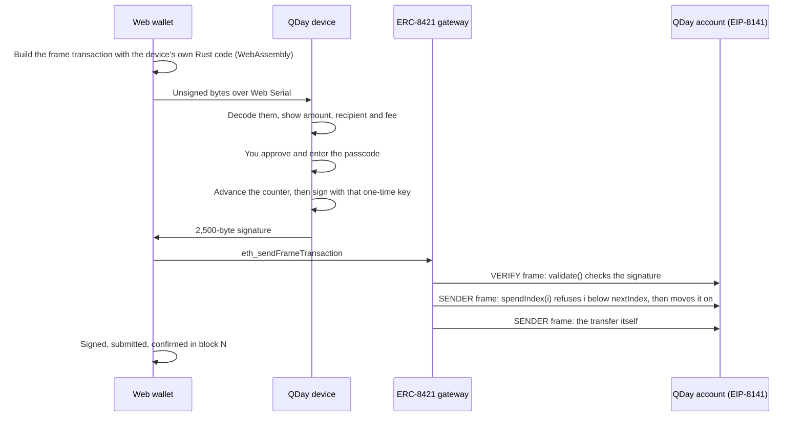

# QDay

**A quantum-safe hardware wallet for Ethereum.** A small device signs with hash-based signatures
that a quantum computer can't forge, and an EIP-8141 smart account accepts nothing else: there is no
ECDSA key anywhere. Two independent locks make sure no one-time key is ever used twice.

**[Open the wallet](https://qday.unitlabs.xyz)** · [Roadmap](docs/ROADMAP.md) · [Signature spec](docs/xmss-spec.md) · [Measured on-chain](docs/devnet.md) · [For AI reviewers](AGENTS.md)


> Built at ETHGlobal Mumbai, November 2026. A working prototype on an EIP-8141 devnet: not audited, not
> for real funds. The demo's quantum attacker is simulated; the signatures, the counters and the
> on-chain checks are real.

## The problem

An Ethereum account's public key is revealed by its first transaction, and secp256k1 falls to Shor's
algorithm: 2026 estimates put the attack at about 1,200 logical qubits
([fact-check](docs/fact-check.md), item 1). Funds that sit in exposed accounts on that day can be taken,
and everyone will be trying to move at once. Hash-based signatures survive a quantum computer, but
they are one-time keys: sign two different messages with one key and it can be forged. They need
hardware that never reuses a key, and an account that checks.

## What QDay is

| | |
|---|---|
| **The device** | An ESP32-S3 with a touch screen and four keys. It holds 1,024 one-time keys per tree, decodes every transaction itself, shows exactly what it will sign, and signs only when you approve and enter your passcode. |
| **The account** | An EIP-8141 smart account. Its VERIFY frame checks a 2,500-byte hash-based signature in Solidity, and its spend frame moves `nextIndex` forward, so a used key is refused. |
| **The wallet** | A web app that connects to the device over USB with Web Serial: create the account, send ETH and tokens, follow each step, and read every transaction back with a built-in explorer. |
| **The network** | QDay's own EIP-8141 devnet, always on: ethrex, Lighthouse and the ERC-8421 gateway that carries frame transactions. |

## How a transfer works



The first transaction deploys the account: its address follows from the device's key through a
CREATE2 factory before anything exists, so you fund it, approve **Create account**, and it pays for its
own deployment.

## Screens

The send dialog: choose a token, check the review against the device, and watch it land.


The device, rendered to PNG by the same code it runs: the wallet, a transfer under review, and the
result.


Standard explorers can't read frame transactions, so the wallet has its own at `/tx/<hash>`. This is a
USDC transfer the device signed, with each frame and the gas it used.


Five device themes, one review screen:


## What's measured

On QDay's devnet, signed on the device and read back with the built-in explorer
([devnet notes](docs/devnet.md)):

| Transaction | Total gas | VERIFY frame |
|---|---|---|
| Create the account (deploys it) | 464,530 | |
| Send 0.0001 ETH | 197,171 | 123,577 |
| Send 29.5 USDC | 207,094 | 111,607 |
| Rotate to a new key tree | 316,334 | 129,827 |

| | |
|---|---|
| Signature size | 2,500 bytes |
| Verifier, per signature, in Foundry | 68,537 to 87,297 gas |
| Building a key tree on the device | 99 seconds, once per 1,024 keys |
| Reusing a spent key, with a valid signature | Refused: `KeyAlreadyUsed` |
| Signing with a retired tree's key | Refused: `BadSignature` |

## Security model

- **Two locks on every one-time key.** The device advances a counter in flash *before* it signs, so it
  never signs twice with one key. The account refuses any index below `nextIndex`, so the chain
  never accepts a key twice, even from a cloned device.
- **The device decodes what it signs.** It accepts only the exact transaction shapes it understands,
  shows ETH and token transfers in plain terms (USDC and WBTC by name, any other token with a warning
  and raw units), and has no command to sign a bare hash.
- **No ECDSA anywhere.** The account's only key is the hash-based one; nothing an old key could do
  survives.
- **Recovery without a company.** 24 backup words rebuild the keys; a restored device reads `nextIndex`
  from the chain and skips 64 keys ahead.
- **The same address forever.** Keys 1008 to 1023 can only switch the account to a new tree.

Not yet: the ESP32-S3 isn't a secure element, so a flash image can be dumped and restored; the chain's
lock still refuses reuse, and an eFuse or secure-element counter is on the [roadmap](docs/ROADMAP.md).
EIP-8141 is a draft considered for the Hegotá upgrade, so QDay runs only on devnets. The scheme is
QDay's own keccak256 variant of XMSS, not RFC 8391, and nothing here is audited.

## Try it

**In the browser:** open **[qday.unitlabs.xyz](https://qday.unitlabs.xyz)** in Chrome, Edge or Brave
with a QDay plugged in. Select **Connect device**, then **Get test ETH** and **Create account**, and
send. Without a device, run the wallet locally with `?mock` to look around.

**Locally:**

```bash
pnpm install
VITE_QDAY_NETWORK=hosted pnpm dev      # the wallet against the hosted devnet
tools/devnet/local/up.sh && pnpm dev   # or your own devnet (Docker), then the wallet against it
```

**The device:** wiring, flashing and first start are in [firmware/README.md](firmware/README.md).

## Check it

```bash
cargo test --workspace --locked          # 405 tests: signature scheme, device logic, screens, CLI
cd contracts && forge test               # 62 tests: verifier, account and factory, on real signatures
pnpm -r test                             # 10 tests: Web Serial protocol, WebAssembly codec against the CLI
tools/devnet/smoke.sh                    # 14 checks with real transactions on a devnet
```

CI runs the Rust and contract checks, including `clippy -D warnings` and `fmt`, on every pull
request. [AGENTS.md](AGENTS.md) maps each claim in this README to the code and the test that back it.

## Repository

| Path | What |
|---|---|
| [`crates/qday-xmss`](crates/qday-xmss) | The signature scheme, `no_std` |
| [`crates/qday-wallet`](crates/qday-wallet) | Device logic without hardware: counter, keys, passcode, backup, USB protocol, frame transactions |
| [`crates/qday-ui`](crates/qday-ui) | Device screens and five themes, rendered to PNG on the laptop |
| [`crates/qday-cli`](crates/qday-cli) | The `qday` laptop tool |
| [`crates/qday-wasm`](crates/qday-wasm) | The frame-transaction code, compiled for the browser |
| [`firmware`](firmware) | The ESP32-S3 app |
| [`contracts`](contracts) | Foundry: `XMSSVerifier`, `QDayFrameAccount`, `QDayAccountFactory` |
| [`web`](web), [`packages`](packages) | The web wallet, its Web Serial protocol and its WebAssembly wrapper |
| [`deploy`](deploy) | The hosted devnet and the hosted wallet (Coolify) |
| [`tools/devnet`](tools/devnet) | Local devnet, contract deploys and the smoke test |
| [`hardware`](hardware) | The printable case |

## Docs

- [Roadmap](docs/ROADMAP.md): what's built, what's next, and what real funds would need
- [Signature scheme](docs/xmss-spec.md): the byte-exact definition and test vectors
- [Devnet notes](docs/devnet.md): endpoints, contract addresses and every measurement
- [Overview](docs/overview.md): the idea in two pages
- [Fact-check](docs/fact-check.md): each external claim in the pitch, checked against its source
- [Risks](docs/risks-and-blockers.md): what could have sunk it, and where each stands
- [Web wallet](web/README.md), [hosted devnet](deploy/coolify/README.md), [firmware](firmware/README.md)

The seed is the entropy of 24 BIP39 words; each tree's secrets come from it with keccak256, as set out
in the [signature scheme](docs/xmss-spec.md#keys). This is QDay's own construction, because no
standard exists for it yet.
