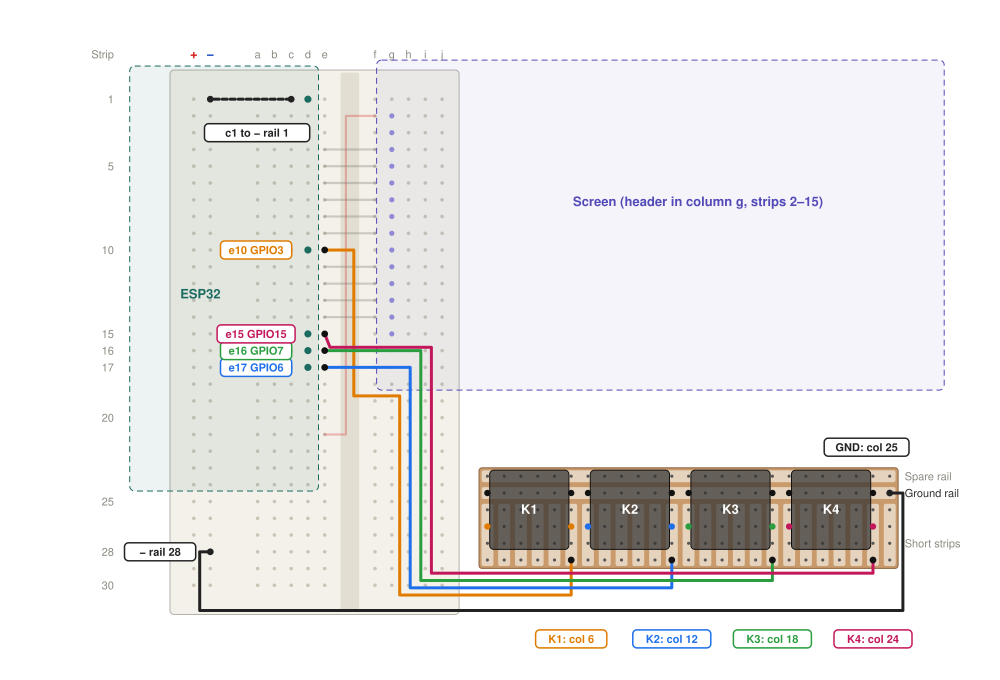

# QDay firmware

The QDay wallet for the YD-ESP32-S3 N16R8 and the MSP2807 2.8" display (ILI9341, XPT2046 touch), with
four keys and the board's WS2812 as a status light.

This crate only connects hardware to the shared crates. Every decision is made in `qday-ui` and
`qday-wallet`, where it's tested on the laptop. It's kept out of the host workspace because it needs
the Xtensa toolchain.

## Wiring

Both boards plug into one 400-hole breadboard, so each signal is a short straight jumper across the
centre gap. Unplug USB while wiring.


Hold the breadboard with the ESP32's USB-C ports at the top. Columns run a (left) to j (right), and
strips are counted from the top, whatever numbers the breadboard prints.

- **ESP32:** plug the header that starts GND, 5V, GPIO14 into column d, strips 1-22, with GND on
  strip 1. The board hangs off the left, and its other header stays unplugged.
- **Screen:** plug its header into column g, strips 2-15, with VCC on strip 2. The board hangs off
  the right, over columns h-j.

Lay the first two wires before plugging in the screen and the short jumpers:

| Screen pin | Strip | ESP32 pin | Jumper |
|---|---|---|---|
| 1 VCC | 2 | 3V3 (strip 21) | e21 to f2, along the centre gap |
| 2 GND | 3 | GND (strip 1) | h1 to h3 under the screen, then e1 to f1 |
| 3 CS | 4 | GPIO13 | e4 to f4 |
| 4 RESET | 5 | GPIO12 | e5 to f5 |
| 5 DC/RS | 6 | GPIO11 | e6 to f6 |
| 6 SDI (MOSI) | 7 | GPIO10 | e7 to f7 |
| 7 SCK | 8 | GPIO9 | e8 to f8 |
| 8 LED | 9 | GPIO46 | e9 to f9 |
| 9 SDO (MISO) | 10 | Not connected | None |
| 10 T_CLK | 11 | GPIO8 | e11 to f11 |
| 11 T_CS | 12 | GPIO18 | e12 to f12 |
| 12 T_DIN | 13 | GPIO17 | e13 to f13 |
| 13 T_DO | 14 | GPIO16 | e14 to f14 |
| 14 T_IRQ | 15 | Not connected | None |

Never bridge strip 2 or strip 3 across the gap. Strip 2 on the ESP32 side is 5V, and strip 3 is
GPIO14.

## Button wiring

Four 12 mm tactile buttons sit on a 25 x 6 hole piece of stripboard, to the right of the breadboard
and under the screen. They need no resistors, because the firmware turns on the internal pull-ups.
Unplug USB while wiring.



Hold the piece with the button side up and the two long rails at the top. Count columns 1-25 from
the left and rows 1-6 from the top. Row 1 is a spare rail, row 2 is the ground rail, and rows 3-6
are short strips, with each column's four holes joined.

Each button has four legs, in rows 2 and 4. Check with a multimeter first: the two legs that beep
without pressing are the pair 5 holes apart, and they go in the ground rail.

| Button | Columns | Wire from row 6 | Breadboard | ESP32 pin |
|---|---|---|---|---|
| K1 | 1 and 6 | Column 6 | e10 | GPIO3 |
| K2 | 7 and 12 | Column 12 | e17 | GPIO6 |
| K3 | 13 and 18 | Column 18 | e16 | GPIO7 |
| K4 | 19 and 24 | Column 24 | e15 | GPIO15 |

Ground takes two wires:

1. Lift the ESP32 out, lay a jumper from c1 to the minus rail at strip 1, and push the ESP32 back in.
2. Run a wire from column 25 of the ground rail to the minus rail at strip 28.

The K1 wire runs up the centre gap from strip 19 to strip 10, under the touch jumpers on strips
11-14. Keep every wire flat, because three of them run under the screen.

Before plugging in USB, check each button with a multimeter. Each signal wire should beep to ground
only while its own button is pressed.

## Build and flash

Connect the board with the port labelled **USB**, then run:

```bash
source ~/export-esp.sh
cargo run --release
```

To build without flashing, use `cargo build --release`. Run both from this folder, so the custom
partition table in `partitions.csv` is used.

The `qday` partition at 0x310000 holds the keys, the counter and the passcode. Reflashing the app
leaves it alone.

## First start

1. Touch the three crosses to calibrate the screen. Hold K1 at start to do this again later.
2. The device makes a seed from the hardware random number generator and builds tree 0, with a
   progress bar. Building a tree took 99 seconds when measured on the device.
3. It restarts and asks you to choose a 6-digit passcode, twice.

Later starts should take about a second.

## Secure element (off by default)

An ATECC608A can hold the XMSS counter outside the flash, so restoring an old flash image can't
rewind it. A normal build doesn't touch the chip or GPIO 4 and 5. This code has never run on a real
chip.

| ATECC608A pin | Connects to |
|---|---|
| 5, SDA | GPIO 5, with 4.7 kΩ to 3V3 |
| 6, SCL | GPIO 4, with 4.7 kΩ to 3V3 |
| 8, VCC | 3V3, with 100 nF to ground |
| 4, GND | ground |

Build with `--features atecc-probe` first. It only reads, and reports the chip's revision, its lock
state and its counter as a log line every three seconds. Microchip's own test locks the config zone
before using the counter, so a chip with an unlocked config may refuse it, and the report shows
that. Locking can't be undone, and nothing here does it.

`--features atecc-counter` then pairs the chip's counter 1 with the flash counter. They're kept
level, the wallet uses the larger, and it signs nothing if either fails. Each signature moves the
chip's counter for good, and it stops at 2,097,151. Both counters move on every signature, so a
wallet keeps its place when the feature is turned on or off. A gap over 2048 between them stops
signing, which is what a forged flash value looks like.

Still open:

- The I2C wires are unauthenticated, so someone on the bus can lie about the counter.
- Someone who restores the flash and also swaps in a chip with a lower count rewinds the counter.
- Each key's counter base sits in the flash with no secret behind it, so someone who can write the
  flash can raise it and rewind the key index.

## Status light

| Colour | Meaning |
|---|---|
| Amber | Waiting for your decision |
| Green | Signed |
| Red | Refused |

## Problems

| Problem | Likely cause |
|---|---|
| White screen | CS, RESET, DC, MOSI or SCK wiring |
| Dark screen | VCC, GND or LED wiring, or no firmware running |
| Picture turns to noise | The LCD clock is too fast for the wires: lower `LCD_MHZ` in `src/main.rs` |
| Flashing cannot connect | GPIO46 is a boot pin: unplug the e9 to f9 jumper, flash, then replace it |
| Red and blue swapped | Change `ColorOrder::Bgr` to `ColorOrder::Rgb` in `src/main.rs` |
| Text mirrored | Remove `.flip_horizontal()` in `src/main.rs` |
| Text upside down | Change `.flip_horizontal()` to `.flip_vertical()` in `src/main.rs` |
| Touches land in the wrong place | Hold K1 while starting, then redo the calibration |
| One key never works | That button's signal wire, or its solder joints |
| No key works | The ground wires: c1 to the minus rail, or the ground rail to the minus rail |
