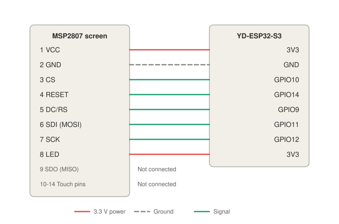

# QDay firmware

Touch test for the YD-ESP32-S3 N16R8 and the MSP2807 2.8" display (ILI9341, 240x320, XPT2046
touch). It starts the screen in landscape and draws a dot wherever you press.

## Wiring

Both boards plug into one 400-hole breadboard, so each signal is a short straight jumper across the
centre gap. Unplug USB while wiring.



Hold the breadboard with the ESP32's USB-C ports at the top. Columns run a (left) to j (right), and
strips are counted from the top, whatever numbers the breadboard prints.

- **ESP32:** plug the header that starts GND, 5V, GPIO14 into column d, strips 1-22, with GND on
  strip 1. The board hangs off the left, and its other header stays unplugged.
- **Screen:** plug its header into column g, strips 2-15, with VCC on strip 2. The board hangs off
  the right, over columns h-j.

Lay the first two wires before plugging in the screen and the short jumpers:

| Screen pin | Strip | ESP32 pin | Jumper |
|---|---|---|---|
| 1 VCC | 2 | 3V3 (strip 21) | e21 to f2, along the centre gap |
| 2 GND | 3 | GND (strip 1) | h1 to h3 under the screen, then e1 to f1 |
| 3 CS | 4 | GPIO13 | e4 to f4 |
| 4 RESET | 5 | GPIO12 | e5 to f5 |
| 5 DC/RS | 6 | GPIO11 | e6 to f6 |
| 6 SDI (MOSI) | 7 | GPIO10 | e7 to f7 |
| 7 SCK | 8 | GPIO9 | e8 to f8 |
| 8 LED | 9 | GPIO46 | e9 to f9 |
| 9 SDO (MISO) | 10 | Not connected | None |
| 10 T_CLK | 11 | GPIO8 | e11 to f11 |
| 11 T_CS | 12 | GPIO18 | e12 to f12 |
| 12 T_DIN | 13 | GPIO17 | e13 to f13 |
| 13 T_DO | 14 | GPIO16 | e14 to f14 |
| 14 T_IRQ | 15 | Not connected | None |

Never bridge strip 2 or strip 3 across the gap. Strip 2 on the ESP32 side is 5V, and strip 3 is
GPIO14.

## Build and flash

Connect the board with the port labelled **USB**, then run:

```bash
source ~/export-esp.sh
cargo run --release
```

To build without flashing, use `cargo build --release`.

## Expected result

The firmware turns the backlight on once the screen has started. The screen shows `Touch the screen`
in white on black, and each press draws a yellow dot. The serial monitor prints a `touch:` line for
each reading, with the raw position, the pressure and the pixel position.

| Problem | Likely cause |
|---|---|
| White screen | CS, RESET, DC, MOSI or SCK wiring |
| Dark screen | VCC, GND or LED wiring, or no firmware running |
| Flashing cannot connect | GPIO46 is a boot pin: unplug the e9 to f9 jumper, flash, then replace it |
| Red and blue swapped | Change `ColorOrder::Bgr` to `ColorOrder::Rgb` in `src/main.rs` |
| Text mirrored | Remove `.flip_horizontal()` in `src/main.rs` |
| Text upside down | Change `.flip_horizontal()` to `.flip_vertical()` in `src/main.rs` |
| No dots and no `touch:` lines | T_CLK, T_CS, T_DIN or T_DO wiring |
| Dots away from your finger | Adjust the `RAW_X_*` and `RAW_Y_*` values in `src/main.rs` |
