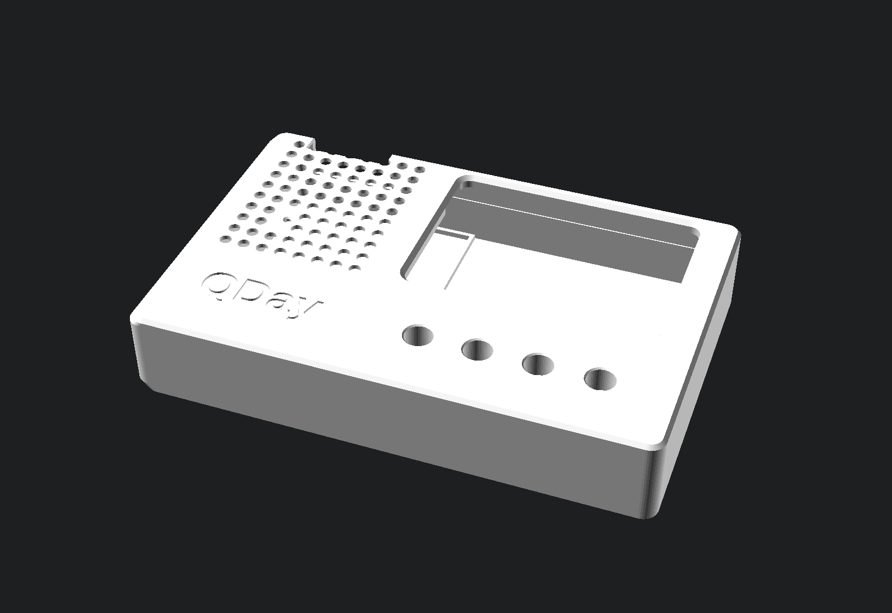
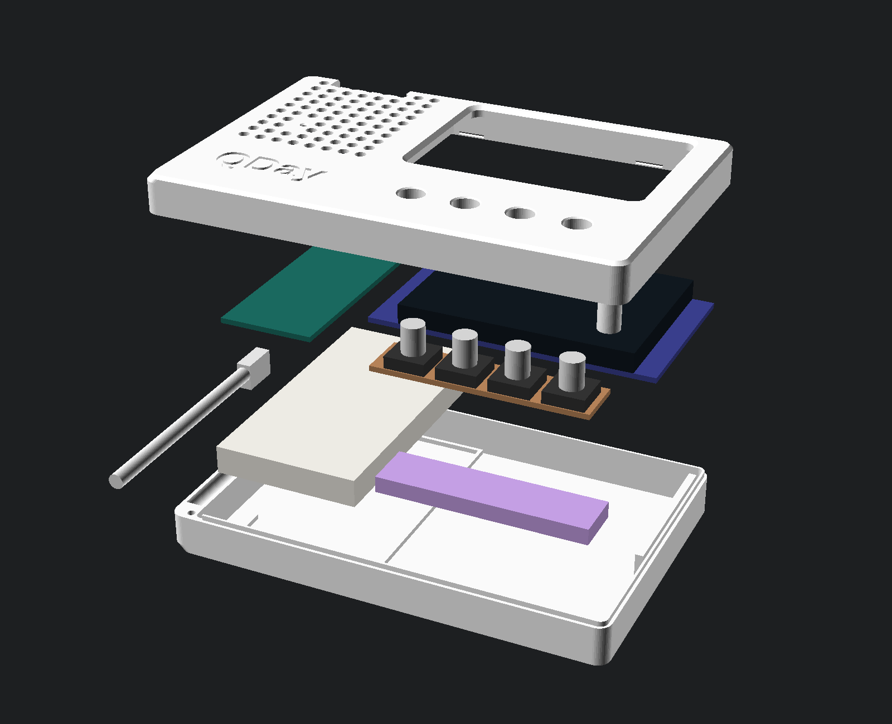

# QDay case

A 3D-printable case for the QDay device, modelled in OpenSCAD. It is a two-part shell, with a tray
and a bezel, plus a key spacer and a fit-test coupon.






## Parts

| File | Part | Print orientation |
|---|---|---|
| `tray.stl` | Lower shell | Floor down |
| `bezel.stl` | Upper shell | Face down |
| `shim.stl` | Key spacer | Flat |
| `coupon.stl` | Fit-test pieces | As exported |

The STL files are already turned to their print orientation.

You also need two M2 x 8 countersunk screws. Both go in from underneath.

## Printing

Use PLA with 0.2 mm layers, 3 walls and 15% infill, with no supports. The Bambu A1 mini fits one
large part at a time. Print `coupon.stl` first to check the fit.

The bezel prints face down, so the floor of the logo recess is a flat ceiling on the printer. It
should bridge the short letter strokes without supports, but it may come out slightly rough.

## Assembly

Place the key spacer at x 45.4, just clear of the breadboard fence. If it lines up with the
stripboard's left edge, it runs 1.12 mm into the fence's right bar.

## Exporting

Run these from this folder:

```bash
openscad --backend=manifold -D 'part="tray"' -o tray.stl qday-case.scad
```

```bash
openscad --backend=manifold -D 'part="bezel"' -o bezel.stl qday-case.scad
```

```bash
openscad --backend=manifold -D 'part="shim"' -o shim.stl qday-case.scad
```

```bash
openscad --backend=manifold -D 'part="coupon"' -o coupon.stl qday-case.scad
```

For the previews, set `part` to `closed` or `assembly`. Set `explode` to a value above 0 to pull the
assembly apart.
