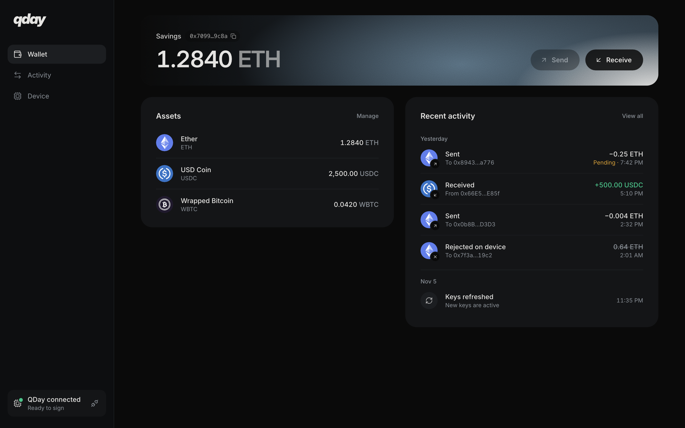
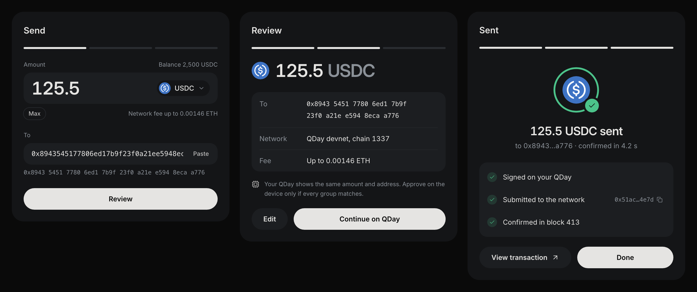

# QDay web wallet

The browser side of QDay: connect the device over USB, create the account, send ETH and tokens, and
read what happened. Live at **[qday.unitlabs.xyz](https://qday.unitlabs.xyz)** on QDay's hosted
devnet.



## Run it

From the repository root:

```bash
pnpm install
pnpm dev                                  # local devnet (tools/devnet/local/up.sh)
VITE_QDAY_NETWORK=hosted pnpm dev         # QDay's hosted devnet, no setup needed
```

Open `http://localhost:5173` in Chrome, Edge or Brave on desktop (Web Serial needs one of them).
`?mock` shows sample data without a device, and `?gallery` shows every state of the send dialog,
including a button that plays the whole flow.

| Network | RPC | Gateway | Test funds |
|---|---|---|---|
| `local` (default) | `127.0.0.1:8545` | `127.0.0.1:14337/rpc` | Built-in faucet and test tokens |
| `hosted` | `rpc-qday.unitlabs.xyz` | `gateway-qday.unitlabs.xyz/rpc` | Built-in faucet and test tokens |
| `public` | the shared alt-mempool devnet | its gateway | Its faucet |

## What it does

- **Connect.** Over Web Serial, with the device's own text protocol (`packages/device`). Disconnect
  makes the browser forget the port, so a reload stays disconnected.
- **Create the account.** The address comes from the device's key through the factory before anything
  is deployed. Get test ETH, then approve **Create account** on the device; the account pays for its
  own deployment.
- **Send ETH or a token.** Pick the token, the amount and the recipient, compare the review with the
  device's screen, approve on the device, and watch it go: signed, submitted with its hash, confirmed
  in block N.
- **See activity.** Read from the chain, with no indexer: own transactions, incoming ETH and ERC-20
  transfers.
- **Explore any transaction.** `/tx/<hash>` decodes a frame transaction frame by frame (verify, spend a
  key, the action) with the gas each used. Standard explorers can't read frame transactions.



## How a send works

1. `useSend` builds the unsigned frame transaction with **the device's own Rust code** compiled to
   WebAssembly (`crates/qday-wasm`, wrapped by `packages/frame`), so the browser, the laptop tool and
   the device can never disagree about the bytes.
2. The bytes go to the device over Web Serial. The device decodes them itself, shows the amount,
   recipient and fee, and signs only if you approve.
3. The wallet submits the signed transaction to the gateway with `eth_sendFrameTransaction`, then
   polls for the receipt every half second.

## Where things are

| Path | What |
|---|---|
| `src/App.tsx` | Connection state, the shell, pages and dialogs |
| `src/pages.tsx` | Wallet, Activity and Device pages |
| `src/components/SendFlow.tsx` | The send dialog: details, review, approval, progress and result |
| `src/TxPage.tsx`, `src/lib/explorer.ts` | The built-in explorer |
| `src/lib/chain.ts` | Networks, balances, the faucet, submission and receipts |
| `src/lib/activity.ts` | Activity from blocks and logs |
| `src/lib/useSend.ts`, `src/lib/useCreateAccount.ts` | The send and account-creation flows |
| `src/lib/useDevice.ts` | The device connection |
| `src/lib/schemes.ts` | Signature schemes as data, so screens don't assume XMSS |

## Checks

```bash
pnpm -r typecheck        # web, packages/device, packages/frame
pnpm -r test             # device protocol, and the wasm checked against the CLI byte for byte
pnpm --filter @qday/web build
```

The production build for Coolify is in [`deploy/web`](../deploy/web).
